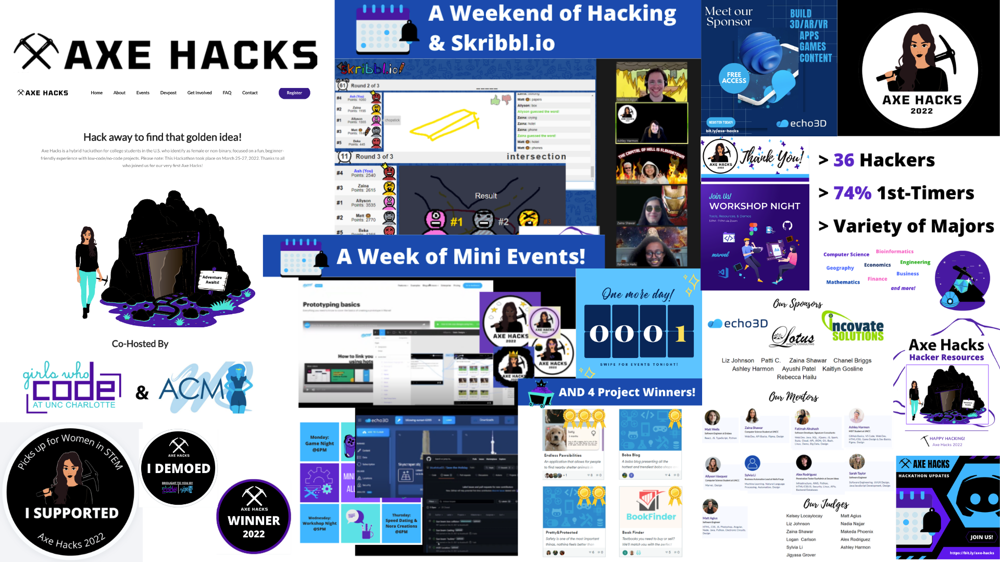

**[💻 Website](https://gwc-uncc.github.io/axe-hacks-2022/)** &nbsp;|&nbsp; **[💻 Devpost](https://axe-hacks-2022.devpost.com/)** &nbsp;|&nbsp; **[📘 Hacker Resources]()** &nbsp;|&nbsp; **[🎥 Hack 101](https://youtu.be/es-kM5juPpc)** &nbsp;|&nbsp; **[🎥 Workshop Night](https://youtu.be/OsHPq4dgL1M)**

I worked with GWC and ACM-W at UNC Charlotte to create the very first Axe Hacks! This was a hackathon focused on a fun, beginner-friendly experience with low-code/no-code projects for women and non-binary college students.

We hosted a week of mini events and then had a weekend of hacking and games. The mini events included things like Hack 101 (an intro to hackathons and why you should participate in them), Workshop Night (hacker resources, tools, and tips to get started), Speed Dating (to find team members), and Nora Creations (make your own version of the logo). We had a total of 36 hackers, the majority of which were at a hackathon for the first time!

**Below are some of the things I did with Axe Hacks 2022:**

- 📝 **PLAN** - events, schedule, and theme
- 🎨 **DESIGN** - logo, website, stickers, hats etc.
- 🛠️ **BUILD** - website, hacker resources guide
- 👩‍💻 **COORDINATE** - speakers, sponsors, attendees, announcements, etc.
- 📱 **ADVERTISE** - social media, flyers, etc.
- 🎥 **HOST/CO-HOST** - events, virtual hangouts, games

**Tools/Platforms Used:**

- ▪ **GitHub | Git | VS Code | Hugo | HTML | CSS** (Website)
- ▪ **Google Calendar | Google Forms** (Schedule, Volunteer/Sponsor Submissions)
- ▪ **Adobe Photoshop | Canva** (Ads, Flyers, Website content, Logo, Merch)
- ▪ **YouTube | Zoom** (Events, Recordings, Virtual Hangouts)
- ▪ **Discord | LI | IG | X** (Marketing, Announcements, Chats)