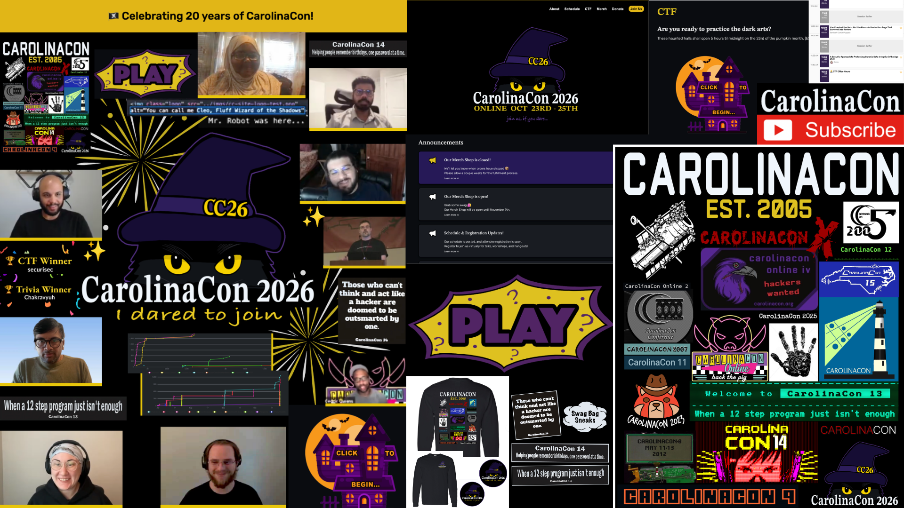

CarolinaCon is a hacking conference put together annually since 2005. It's a place for both local and global communities to learn more about technology, information/network/computer security, and information rights.

I've been attending CarolinaCon since 2017, and for the 2026 conference, I got to help run it! I had such a blast working with fellow UNC Charlotte alum that I met in the 49th Security Division, and getting to learn new tools and skills throughout the process. 

**Below are some of the things I did with CarolinaCon 2026:**

- 📝 **PLAN** - events, schedule, and theme
- 🎨 **DESIGN** - logo, website, t-shirts, stickers, posters, etc.
- 🛠️ **BUILD** - CTFd setups, website, merch shop
- 👩‍💻 **COORDINATE** - speakers, attendees, announcements, etc.
- 📱 **ADVERTISE** - social media, flyers, etc.
- 🎥 **CO-HOST** - the livestreams, virtual hangouts, Hack 101 Workshop

**Tools/Platforms Used:**

- ▪ **CTFd** (Trivia Game and CTF Competition)
- ▪ **Pretalx** (Schedule, Speaker Submissions)
- ▪ **GitHub, Git, VS Code, HTML, CSS** (Website)
- ▪ **Shopify** (Merch Shop)
- ▪ **Adobe Photoshop** (Ads, Flyers, Website content, Logo, Merch)
- ▪ **YouTube | Jitsi** (Livestreams, Virtual Hangouts)
- ▪ **Discord | Matrix | LI | IG | X | Mastadon** (Marketing, Announcements, Chats)

**[💻 Website](https://carolinacon.org)** &nbsp;|&nbsp; **[🎥 Livestreams](https://www.youtube.com/@CarolinaCon)** &nbsp;|&nbsp; **[🎥 Hack 101]()** &nbsp;|&nbsp; **[🕵️‍♂️ Trivia Game](https://trivia.carolinacon.org/)** &nbsp;|&nbsp; **[👩‍💻 CTF](https://ctf.carolinacon.org/)** &nbsp;|&nbsp; **[🛍️ Merch Shop](https://yr9tgk-1m.myshopify.com/)**