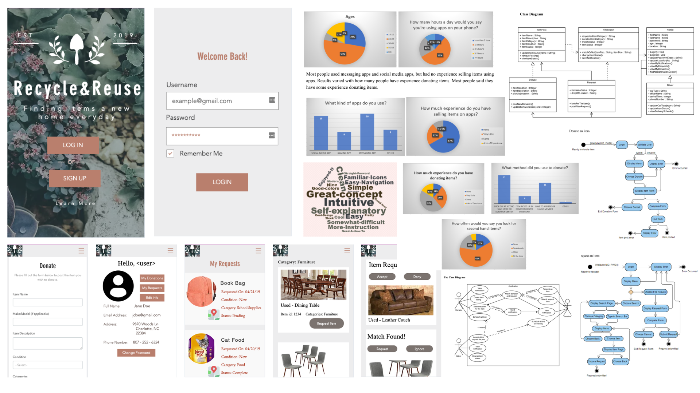

This is a project for a mobile app version of the Recycle & Reuse idea. My team and I conducted needfinding, designed a mobile app prototype,  conducted user studies, and wrote about our findings. 

This process was a lot of fun, to take an idea about painpoints in the recycling process, design a solution, and then get feedback from real users. You can checkout some of the documentation below!

**[📘 UML Diagrams](https://drive.google.com/file/d/1bBXq5T9iHCRh6iRgvRo1DaJftwTTdhD-/view)**

&nbsp;

-------------------
&nbsp;

## Project Paper
