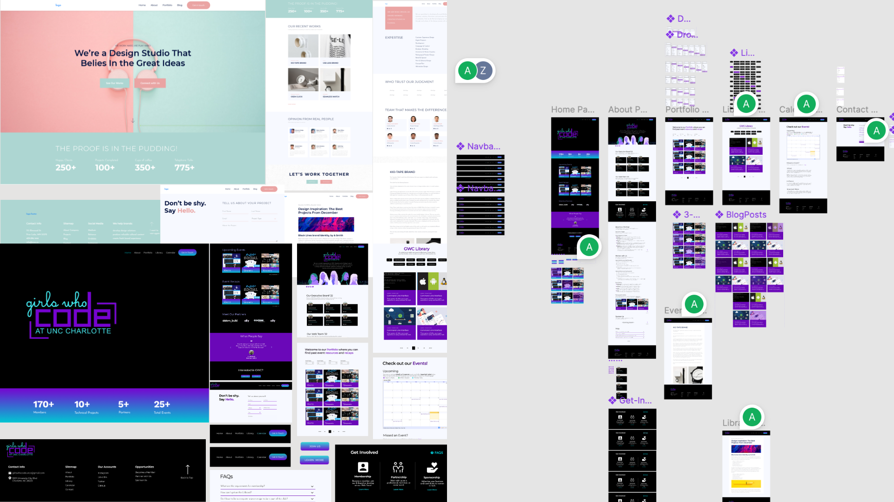

This was a project for the Girls Who Code at UNC Charlotte to develop v2 of the UNCC's chapter website. The goal was for the design and development of this site to be a shared process with GWC members to get hands on experience. We formed the **[GWC Web Team]()** for those who wanted to learn and contribute.

To keep the process simpler in the time we all had around our regular course loads, we decided to work with a Hugo theme that we could adapt to our brand. Workshops were hosted for learning how to setup a development environment, work with GitHub, Git, Hugo, Figma, and more! (You can check those out under Workshops above)

We first created this prototype in Figma to plan the theme changes and have references for colors, fonts, and other styling information for our code changes later on. 

**[💻 Try it Out](https://www.figma.com/proto/YcMIVm9QH4AwPdtsDZqeQW/GWC-Website-Prototype?node-id=314-1042&p=f&t=XSM0HtsfsOFpJEgV-0&scaling=min-zoom&content-scaling=fixed&page-id=238%3A733&starting-point-node-id=314%3A1042&show-proto-sidebar=1)** &nbsp;|&nbsp; **[👩‍🏫 View the Board](https://www.figma.com/design/YcMIVm9QH4AwPdtsDZqeQW/GWC-Website-Prototype?node-id=238-733&p=f&t=XSM0HtsfsOFpJEgV-0)**
