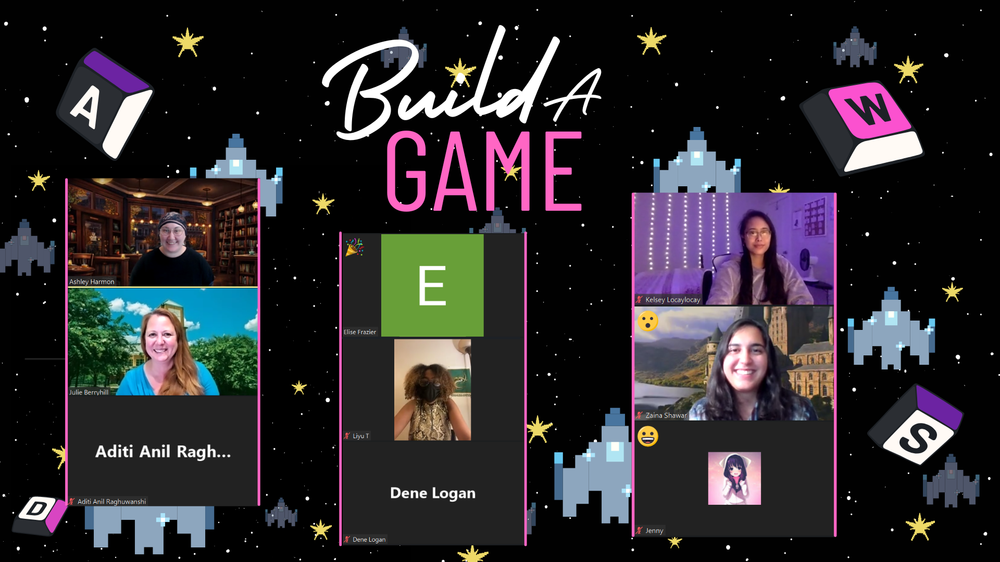

This is a workshop from Girls Who Code at UNC Charlotte with a guide developed by Ashley Harmon. The steps in this guide are following the first section of the [Easy JavaScript Development with Kaboom.js](https://youtu.be/4OaHB0JbJDI) course by Ania Kubów, with updates to accommodate the changes with Kaboom and Replit since that video was made. The steps were typed up for easy following along after our live workshop together, and some extra tips and resources have been added in this guide for those wishing to learn more! 

 **[📘 Workshop Guide]()**

 &nbsp;

-------------------
&nbsp;

## Check out the Games!
