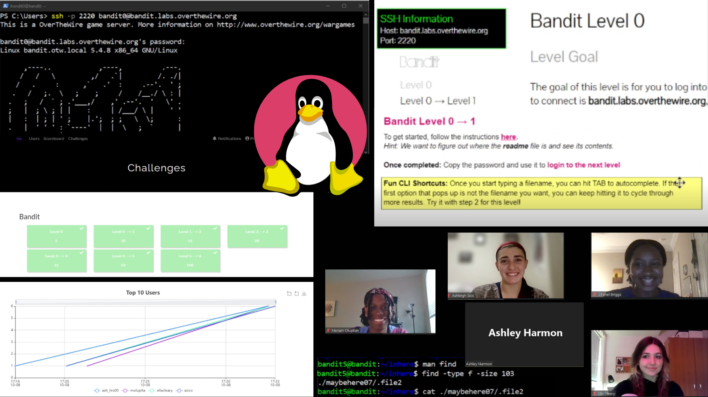

This is a workshop from Girls Who Code at UNC Charlotte where we walked through some of the basics of a CLI vs GUI and how to start playing the OverTheWire command line games. A CTF instance and scoreboard was set up to add some competitive fun!

As this was more live and interactive, there is not a recording for this one, but you can use the workshop guide to learn a bit about CLIs and try the challenges! OverTheWire has many more challenges to explore if you want to keep going as well.

**[📘 Workshop Guide]()**